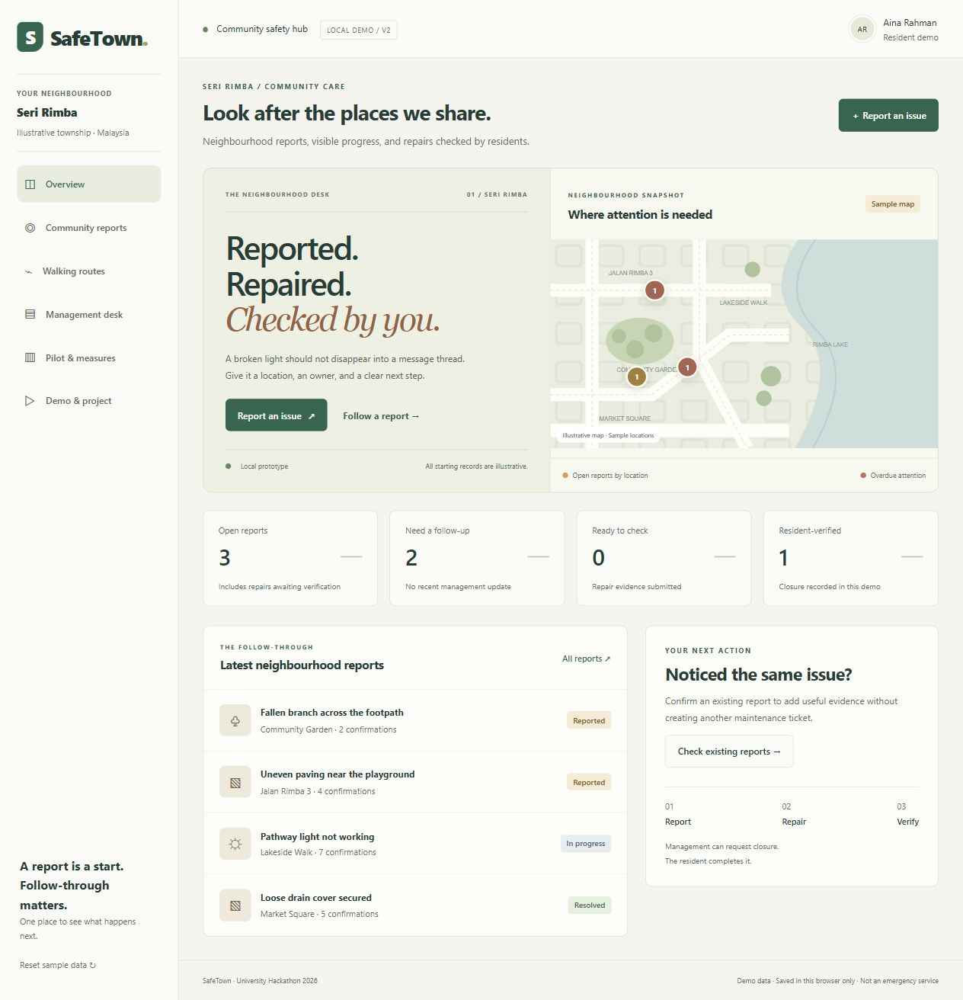

# SafeTown

Built by **Team Vortex**.

## Portfolio development

This branch extends the Team Vortex hackathon project. The public demo remains the submitted version on `main`.

The first extension adds backup restoration: preview a JSON export, add new reports, skip identical records and reject conflicting report IDs without overwriting local data. Exports now include a schema version; earlier SafeTown exports are also supported. Records stay in the browser. Imported data does not establish verified identities.

To try the extension, clone the `codex/portfolio-backups` branch and run `npm start`. Open Community reports, choose **Import backup**, select a SafeTown export and review the preview before choosing **Add these reports**. Imports accept up to 10 MB and 1,000 reports. If an existing report ID has different contents, the import stops so both copies can be retained for review.

### Engineering decisions

- Import adds new IDs rather than silently replacing current reports.
- All records are validated before any write.
- A failed storage write restores the previous in-memory state.
- Identical records are compared independently of JSON property order.
- Regression tests cover legacy exports, invalid formats, unsupported versions, duplicate IDs, conflicts and storage failure.

Run `npm run check` for the regression suite and static build. Manual browser verification of the new upload and preview flow is still pending.

The next milestones are shared storage with authenticated roles, controlled photo access and browser workflow tests. These are planned, not implemented. The original hackathon work remains credited to Team Vortex; subsequent changes are recorded in branch commits.

[Try the live prototype](https://kaiqingkhaw.github.io/safetown/public/)
### A Clear Path for Everyone

**Report. Restore Access. Verify.**

[](https://github.com/kaiqingkhaw/safetown/actions/workflows/checks.yml)

SafeTown is a community safety prototype that connects hazard reporting, maintenance action, and resident verification.

**Our goal: track whether people can use a path again—not simply whether a report has been closed.**

Developed for the **University Hackathon 2026 — People Track**.



## The Problem

A blocked walkway, damaged pavement, or broken streetlight can interrupt everyday journeys.

The same hazard can affect people differently. A small obstacle may be manageable for one pedestrian but prevent a wheelchair user or parent with a stroller from continuing.

Reporting the issue is only the beginning. Residents also need answers:

- Has anyone acknowledged the problem?
- Who is responsible for fixing it?
- What can I do while waiting?
- Has the repair restored access?

## Our Approach

SafeTown demonstrates a repair workflow with residents involved at both ends:

**Report → Assign → Update → Repair → Verify**

Residents describe the problem and its impact on access. Management assigns a team, shares progress, and submits repair evidence. A resident then confirms the repair or reopens the issue with a reason.

The next development phase extends this workflow to address **temporary access and different mobility needs**.

## What Makes SafeTown Different?

### 1. Report the impact, not only the defect

Reports capture whether people can pass and who may be affected, alongside the location, description, and optional photo.

This gives management more context than a report title alone.

**Status: Implemented in the prototype.**

### 2. Make repair completion visible

Management must submit a repair photo and notes before requesting verification. Residents can review the result and reopen an unresolved or recurring problem.

Previous repair evidence remains available.

**Status: Implemented as a demonstration workflow. Independent identities are not yet verified.**

### 3. Restore access while repairs are pending

A proposed **Temporary Access Plan** would let management publish a checked alternative entrance, temporary passage, or other interim arrangement.

Each plan would include:

- Who checked the arrangement and when.
- Applicable access needs.
- Supporting photos and instructions.
- Operating hours or an expiry time.
- A way to report that the arrangement no longer works.

**Status: Planned.**

### 4. Explain route suitability for different needs

The current prototype compares fixed sample routes and highlights reported accessibility concerns under a step-free preference.

The proposed extension would support more travel needs and show why a route may be unsuitable, along with the age and verification status of the supporting reports.

**Status: Illustrative route comparison implemented; real routing and expanded preferences planned.**

## Current Features

| Area | Available functionality |
| --- | --- |
| Resident reporting | Location, description, optional photo, access context, and affected pedestrians |
| Priority suggestions | Editable suggestions based on category and access rules |
| Similar reports | Suggestions for similar unresolved reports at the same location |
| Community participation | Confirmations that an issue has also been observed |
| Management | Team assignment, priority changes, and public progress updates |
| Repair evidence | Required photo and notes before resident verification |
| Verification | Resident confirmation or reopening with a reason |
| History | Timestamped activity and retained previous repair evidence |
| Follow-up | In-app flags based on proposed management-update thresholds |
| Records | Search, status filters, browser persistence, and JSON export |
| Route concept | Fixed sample routes informed by unresolved reports |
| Pilot dashboard | Activity measures that exclude seeded sample records |

## Proposed Innovation Roadmap

These features are **design proposals, not completed capabilities**.

| Feature | Proposed behaviour | Intended value |
| --- | --- | --- |
| Temporary Access Plans | Publish checked interim arrangements while repairs continue | Help residents complete journeys before permanent repairs finish |
| Needs-based route information | Match reported obstacles to selected travel needs | Explain which conditions matter to each user |
| Access-focused verification | Record “Improved,” “Partly improved,” “Still blocked,” or “Unable to assess” | Assess whether the original access problem was addressed |
| Repair planning simulator | Compare repair options using estimated costs and access impacts | Support transparent decisions under a limited budget |

Urgent hazards would require a separate escalation process. Repair priorities should not depend solely on popularity, report volume, or lowest cost.

## A Journey We Want to Support

> A wheelchair user encounters a blocked park entrance on a daily journey.

1. **Report:** The resident records the obstruction and explains that wheelchair access is blocked.
2. **Respond:** Management acknowledges the report and assigns a team.
3. **Provide temporary access — planned:** Management checks another entrance and publishes its access details and opening hours.
4. **Repair:** The team uploads repair evidence and notes.
5. **Verify:** The resident reviews the repair and confirms the outcome or reopens the issue.
6. **Learn:** The team reviews response times, verification outcomes, and recurring problems.

The prototype currently demonstrates reporting, management response, repair evidence, and resident verification. Temporary access is the next proposed extension.

## Demo Walkthrough

1. Create a report at **Park Entrance**.
2. Describe the hazard and its effect on access.
3. Review the suggested priority and submit.
4. Open **Community reports** and add an observation confirmation.
5. Open **Management desk**, assign a team, and publish an update.
6. Upload a repair photo and notes.
7. Return to **Community reports** to verify the repair or reopen it.
8. Explore **Pilot & measures** and **Walking routes**.

Export any records you want to keep before resetting sample data.

## Measuring Success

A pilot should measure more than how many reports are submitted or closed.

Proposed evaluation questions include:

- How long does it take to acknowledge a report?
- How long does it take to provide a checked temporary arrangement?
- How long does it take to reach resident-verified resolution?
- How often are reports reopened?
- Can residents with different access needs complete the reporting and verification tasks?

The current dashboard provides selected local activity measures. Broader access outcomes require user testing and a real pilot.

**No real-world safety improvements or impact results are claimed at this stage.**

## Quick Start

### Open directly

Download the repository and open `public/index.html` in Chrome or Edge.

### Run locally

Requires **Node.js 22 or newer**.

```sh
git clone https://github.com/kaiqingkhaw/safetown.git
cd safetown
npm start
```

Open **http://127.0.0.1:5173**.

No package installation, account, API key, or environment file is required.

Records stay in browser storage. Use the same browser profile and address to retain demo records.

## Technology

| Component | Purpose |
| --- | --- |
| HTML and CSS | Application structure and responsive styling |
| Vanilla JavaScript | User interactions, report workflows, and rules |
| `localStorage` | Local storage of demo records and images |
| SVG | Illustrative map and route display |
| Node.js | Local preview server, checks, and build scripts |

The application has no external runtime dependencies. Priority suggestions use fixed rules; there is no connected AI service.

## Project Structure

```text
public/          Editable website: index.html, style.css, app.js
scripts/         Local preview server and build scripts
tests/           Focused regression checks
docs/            Project scope, verification notes, and preview
.github/         Automated checks and pull-request template
CONTRIBUTING.md  Team contribution workflow
package.json     Project commands
README.md        Project overview and setup
```

**Edit source files in `public/`.** Files in `dist/` are generated.

## Development and Testing

```sh
npm start       # Start the local preview server
npm test        # Run syntax and focused regression checks
npm run build   # Generate static files and portable HTML
npm run check   # Run tests and build
```

The build generates a static website in `dist/` and a standalone demonstration file at `dist/SafeTown.html`.

Automated checks cover selected rules, persistence, invalid page routes, and saved-data recovery. They do not replace manual browser, accessibility, security, or usability testing.

See [verification notes](docs/VERIFICATION.md) for the recorded testing scope.

## Prototype Boundaries

- **Single-browser storage:** No shared database or cross-device synchronization.
- **Demonstration roles:** Role switching is not authenticated access control.
- **Unverified identities:** Confirmations do not prove independent resident participation.
- **Illustrative geography:** Maps and route comparisons are not validated navigation.
- **Incomplete observations:** No reported hazard does not mean a route is safe or accessible.
- **In-app follow-up only:** No external email, SMS, or push notifications.
- **Editable local history:** Activity records are not a tamper-resistant audit log.

SafeTown is not an emergency service. Use synthetic or non-sensitive information in public demonstrations.

## Next Implementation Priorities

1. Test the reporting and verification flow with residents and maintenance staff.
2. Add a shared database, authenticated accounts, and controlled image storage.
3. Prototype Temporary Access Plans with clear verification and expiry.
4. Introduce access-focused repair verification.
5. Evaluate real geographic data and route suitability.
6. Run a small pilot and report its limitations alongside its results.

See [project scope](docs/PROJECT.md) for the existing architecture and scope. The innovation roadmap above proposes extensions to that baseline.

## Contributing

See [CONTRIBUTING.md](CONTRIBUTING.md).

Use a separate branch, run `npm run check`, manually check affected user flows, and open a pull request explaining the change.

Repository owners can invite teammates through **Settings → Collaborators**. Public visibility does not grant direct push access.

## License

No open-source license has been selected. Contact the repository owner regarding permission to reuse, modify, or redistribute the code.
